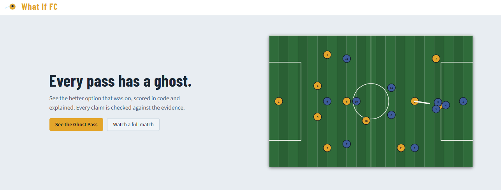
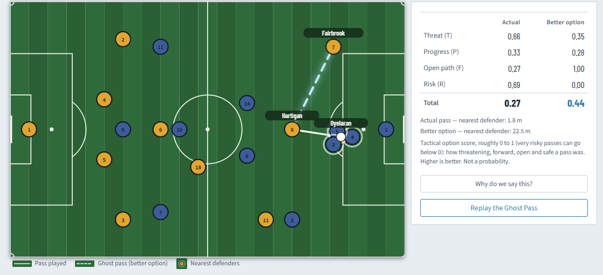
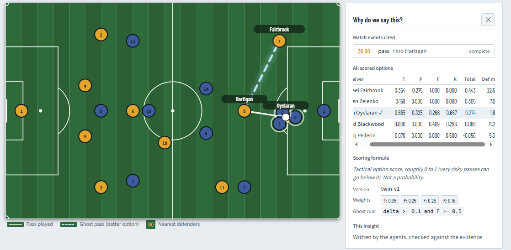
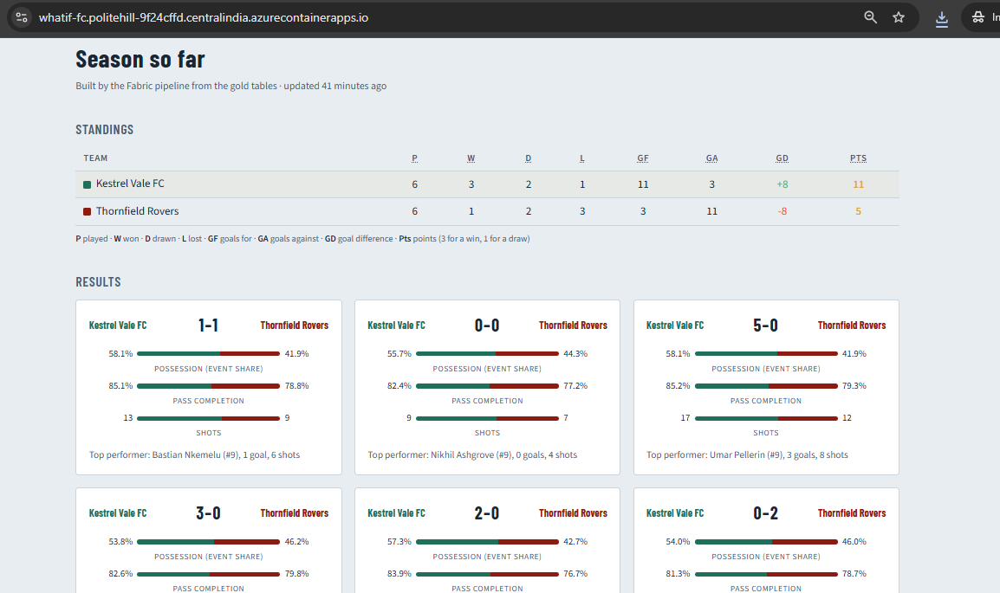
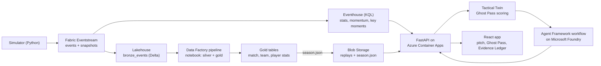
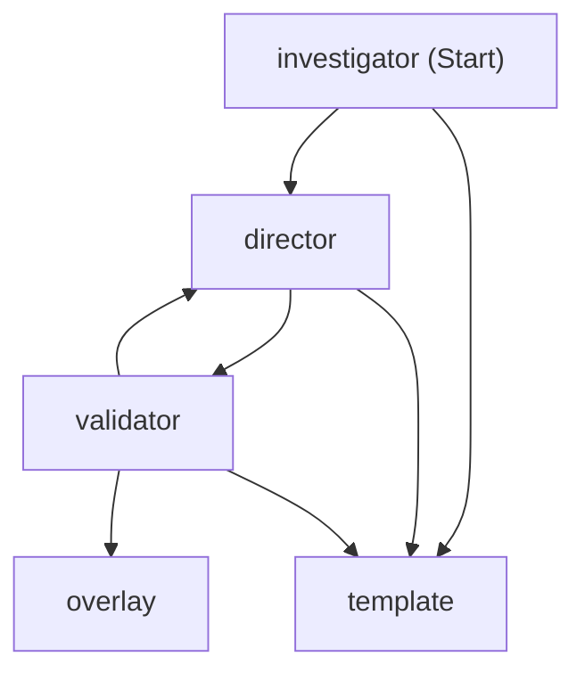

# What If FC ⚽👻

**A normal match dashboard tells you what happened. What If FC shows what else could have happened, and proves why.**

At every key moment, What If FC finds the **Ghost Pass**: the better pass that was available but not played. Two AI agents then explain it, once for the analyst and once for the fan, and every claim on screen links back to its evidence.

**▶ Live app:** https://whatif-fc.politehill-9f24cffd.centralindia.azurecontainerapps.io (no login)
**🎬 Demo video (under 2 minutes):** `<YOUTUBE_OR_VIMEO_LINK>`

> Entry for the Microsoft Premier League Hackathon "Inside the Game" (October 2026), category **Best Azure Cloud Native Integration**. All clubs, players and match data are fictional and generated by this project. No real footage, logos or trademarks are used.



## The problem

Broadcast graphics and stat dashboards report events: passes, shots, possession. They cannot say *what else was on*, which is the question fans argue about and analysts get paid to answer. Generative AI could write that story, but in a live broadcast a single invented number or wrong name destroys trust.

## What it does

1. A simulator streams a synthetic match (events plus player positions) into **Microsoft Fabric**.
2. **KQL** in Eventhouse computes live stats, momentum and pressure, and detects key moments.
3. The **Tactical Twin** (deterministic Python) scores every passing option from the frozen frame and picks the Ghost Pass.
4. Two **Microsoft Agent Framework** agents on **Microsoft Foundry** turn the evidence into text:
   - the **Investigator** reads the evidence packet and writes the analyst finding;
   - the **Broadcast Director** writes the fan headline and a commentary cue.
5. A deterministic **validator** checks every number, name and event ID against the evidence. If a check fails, the agent gets one retry; after that, a template takes over. The screen never shows an unchecked claim.
6. The **React** app animates the actual pass and the Ghost Pass on a pitch, with Analyst, Fan and Compare views and an **Evidence Ledger** ("Why do we say this?").







## Try it in 60 seconds

1. Open the live app and click **See the Ghost Pass**.
2. Watch the actual pass (solid) and the Ghost Pass (dashed) draw on the pitch.
3. Switch between **Fan**, **Analyst** and **Compare**.
4. Click **Why do we say this?** to open the Evidence Ledger.
5. Click **Tour** at the top for a five-step guided walkthrough.
6. Go back and choose **Watch a full match** for a 90-minute replay with a timeline of key moments.
7. Scroll down to **Season so far**: standings, results and team averages built by the Fabric pipeline from the gold tables.

## Architecture



**Agent workflow** (exported from the code with `scripts/export_workflow_diagram.py`):



### Two modes

| Mode | What runs | Why |
| --- | --- | --- |
| **Replay** (default) | Pre-built bundles from Blob Storage, with agent text produced ahead of time | Judges can use the app at any time, even with Fabric paused, at near-zero cost |
| **Live** | Simulator → Eventstream → Eventhouse; a watcher polls KQL every 5 s and runs the Twin and the agents on each new key moment | Shows the real event-driven pipeline end to end, including an instant replay of each moment |

Live mode also has a **Sim outage** switch: the next overlay falls back to the template, which shows the failure path working.

### Cloud native on Azure

| Concern | How |
| --- | --- |
| Event-driven ingestion | Fabric Eventstream custom endpoints → Eventhouse and Lakehouse |
| Batch layer | Fabric Data Factory pipeline runs a Spark notebook: bronze → silver (validated, deduplicated) → gold match, team and player tables, with a data-quality row per run; it also exports `season.json` to Blob for the app's Season page ([details](fabric/lakehouse/README.md)) |
| Compute | Azure Container Apps (FastAPI serves the API and the built React app from one image) |
| Identity | User-assigned managed identity `id-whatif-api` for Blob, Foundry and Fabric; no keys in the app |
| CI/CD | GitHub Actions: lint and tests → image to GHCR → deploy with OIDC federated credentials (no stored Azure secret) |
| AI | Microsoft Foundry (gpt-5-mini) through Microsoft Agent Framework |
| Resilience | Validator retry, then template fallback; replay mode when Fabric is paused |

## Why it is different

| Existing approach | What it does | What What If FC adds |
| --- | --- | --- |
| Event-stat dashboards | Report passes, shots, possession | What else was on, and who it was |
| Tracking freeze frames (for example StatsBomb 360) | Record every player's location at an event | Turn a frame into a judgement on every option |
| Expected Threat (xT) | Values pitch zones from historical data | Scores one pass to one player from that exact frame |
| TacticAI (Google DeepMind and Liverpool, 2024) | Suggests corner-kick adjustments for coaches | Open play, for analysts *and* fans |

The combination is the point: deterministic scoring, evidence-bound agents, a validator with fallback, and an Evidence Ledger anyone can open.

## Honest labels

- Tactical Twin values are heuristic **tactical option scores** (version `twin-v1`: S = 0.35·Threat + 0.25·Progress + 0.25·Freedom − 0.15·Risk). They are not probabilities, expected goals or expected assists, and the validator blocks those words.
- Possession is an event-based proxy.
- All data is synthetic and seeded, so every replay is reproducible.

## Tech stack

Python 3.12 · pydantic · FastAPI · Microsoft Agent Framework · Microsoft Foundry · Microsoft Fabric (Eventstream, Eventhouse/KQL, Lakehouse) · Azure Blob Storage · Azure Container Apps · React + TypeScript + Vite · GitHub Actions · pytest, ruff, Vitest

## Run it locally

Requires Python 3.11+ and Node 22.

```bash
git clone https://github.com/aravindh-c/what-if-fc.git
cd what-if-fc
python -m venv .venv
# Windows: .venv\Scripts\activate     macOS/Linux: source .venv/bin/activate
pip install -e ".[dev]"
git config core.hooksPath .githooks   # pre-push runs lint and tests

ruff check . && pytest -q

# Build replay bundles with template text (no Azure needed)
python -m scripts.build_replay

# Build the web app and serve everything on http://localhost:8000
npm --prefix web ci && npm --prefix web run build
uvicorn api.main:app
```

For frontend development, run `npm --prefix web run dev`; Vite proxies `/api` and `/health` to port 8000.

Azure and Fabric settings go in `.env` (copy `.env.example`; never commit `.env`). With Foundry configured, `python -m scripts.build_replay --agents --upload` builds agent-written bundles and uploads them to Blob Storage.

**Live mode:** needs a running Fabric capacity and the KQL and Eventstream settings in `.env`. Steps are in [`docs/runbook.md`](docs/runbook.md) section 5; the match is streamed with `python -m simulator.publisher --seed 7 --speed 10`.

## API

| Endpoint | Purpose |
| --- | --- |
| `GET /health` | Liveness and mode |
| `GET /api/replays` | Replay catalog |
| `GET /api/replays/{id}` | Full replay bundle |
| `GET /api/live/matches` | Matches currently streaming into Fabric |
| `POST /api/live/{match_id}/watch` | Start the watcher for a match |
| `GET /api/live/{match_id}/state`, `/overlays` | Live clock, stats and checked overlays |
| `GET /api/season` | Season standings, results and team averages from the gold layer (404 until the pipeline has run) |

## Repository layout

| Folder | What lives there |
| --- | --- |
| `core/` | Data contracts (pydantic), pitch geometry |
| `simulator/` | Fictional clubs and players, match engine, demo scenarios, Eventstream publisher |
| `analytics/` | Tactical Twin, evidence packets, metrics, validator |
| `agents/` | Agent Framework workflow, prompts, templates, KQL tools, live moment logic |
| `fabric/kql/` | Eventhouse tables and the 12 KQL functions |
| `fabric/lakehouse/` | Bronze table DDL and the silver/gold notebook run by the pipeline |
| `api/` | FastAPI service, replay store, live watcher |
| `web/` | React frontend |
| `docs/` | Requirements, deployment, runbook, workflow diagram |
| `.github/workflows/` | CI and deployment |

## Testing

422 Python tests (Twin scenarios, validator rules, KQL parity, agent workflow, live watcher, API) plus frontend tests run on every push.

## License

MIT, see [LICENSE](LICENSE).
